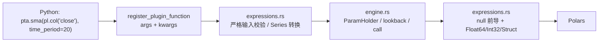

# polars_ta_lib 架构设计

本文档固定项目的技术决策与边界。实现、测试和后续扩展都以这里为准。

## 1. 目标与非目标

### 目标

- 把 TA-Lib 的全部 237 个指标暴露为 Polars 表达式插件。
- 后端使用 TA-Lib 官方纯 Rust crate `ta-lib = "=0.8.3"`，不依赖 C 工具链。
- 顶层函数 API，支持常规列默认值，多 Real 输入必须显式传入。
- 输入契约严格：只接受稠密、有限的 `Float64`；缺失值由调用方处理。
- 输出前导 warm-up 区使用 Polars null，而不是 NaN 或 0。
- Python 参数名和 Struct 字段名使用 snake_case；TA-Lib 原始名保留在元数据/文档中。
- 以 `polars-talib-fast==2.0.0` 作为数值对照 oracle，但不复制其 API 或缺失值语义。

### 非目标（首版）

- `.ta` 表达式命名空间。
- `unstable_period`、candle settings 等 `Core` 配置入口。
- streaming / 增量 API。
- Series 级 API（`pta.sma(series)`）。
- 自定义指标。
- 与 `polars-talib-fast` 的 API 或 NaN 语义完全兼容。

## 2. 决策记录

| 编号 | 决策 | 选择 |
|---|---|---|
| D1 | 项目定位 | 独立实现；cookiecutter 规范骨架 + 分层引擎；fast 仅作测试参照 |
| D2 | 后端 | 官方 `ta-lib 0.8.3`，纯 Rust，无 C 绑定 |
| D3 | API 形态 | 仅顶层函数；`pta.sma(...)`、`pta.atr(...)` |
| D4 | 输入默认值 | C2：单 Real 默认 `close`；price 组件用同名列；多 Real 必须显式 |
| D5 | 缺失值 | N1：输入严格校验；前导输出 Polars null；Int32 前导也是 null |
| D6 | 命名 | P1：参数/Struct 字段 snake_case；函数名为 TA-Lib 名小写 |
| D7 | 首版范围 | 237 函数 + 签名/docstring/`.pyi`/测试/打包；配置与 streaming 后置 |
| D8 | 测试参照 | `polars-talib-fast==2.0.0` + 自有边界测试；归一化 null/NaN 后比较 |
| D9 | 插件协议 | `pyo3-polars` 0.28 `#[polars_expr]` + `register_plugin_function` |
| D10 | 包结构 | `python/polars_ta_lib` + extension `polars_ta_lib._internal` |

## 3. 上游事实

- `ta-lib 0.8.3` 是 TA-Lib 官方 Rust 移植，`#![forbid(unsafe_code)]`，无 `build.rs`、无 `*-sys`、无 `extern "C"`。
- 唯一依赖是内部 crate `ta-lib-dispatch`；它只做 x86 FMA 运行时派发，不是 FFI。
- 237 个函数由 `ta_lib::abstract_api::FUNCS` 在运行时描述：
  - 输入：`Real` 或 `Price`（OHLCV 位掩码）。
  - 参数：`IntegerRange`、`RealRange`、`IntegerList`、`RealList`，含默认值。
  - 输出：`Real` 或 `Integer`。
- `ParamHolder` 支持按索引绑定输入/参数/输出，`lookback()` 给出前导长度，`call(start, end)` 返回 `OutRange { beg_idx, count }`。
- 没有函数使用 `InputType::Integer`；遇到时首版直接报错。
- TA-Lib 不识别 null/NaN/Inf；调用方必须保证输入连续、有限。

## 4. 分层架构

```
Python API 层          python/polars_ta_lib/_build.py
  └─ 元数据 -> 函数/签名/docstring
Polars 边界层          src/expressions.rs
  └─ Series/kwargs -> f64 columns -> Series/Struct
TA-Lib 引擎层          src/engine.rs
  └─ metadata -> ParamHolder -> lookback -> call -> outputs
元数据/命名层          src/meta.rs
  └─ 元数据序列化、P1 命名、输出 dtype
Python 模块出口        src/lib.rs
  └─ #[pymodule] _internal + functions_json() + __version__
```

数据流：



约束：

- `engine.rs` 不 import `polars`，只操作 `&[f64]`、`&[i32]`。
- `expressions.rs` 不知道具体指标，只处理协议、输入校验、输出装配。
- `_build.py` 不硬编码函数名或参数；全部来自 `_internal.functions_json()`。
- `meta.rs` 是唯一做 P1 命名转换的地方，Python 与 Rust 的输出字段名必须一致。

## 5. 项目结构

```
polars-ta-lib/
├── Cargo.toml
├── pyproject.toml
├── mkdocs.yml
├── ARCHITECTURE.md
├── PLAN.md
├── docs/
│   ├── index.md
│   ├── api/                 # 由 tools/generate_docs.py 生成
│   ├── architecture.md      # 生成
│   └── plan.md              # 生成
├── src/
│   ├── lib.rs              # PyO3 模块、PolarsAllocator、metadata 导出
│   ├── expressions.rs      # 唯一 #[polars_expr] fn call
│   ├── engine.rs           # TA-Lib 安全层
│   └── meta.rs             # 元数据、P1 命名、输出 dtype
├── python/polars_ta_lib/
│   ├── __init__.py         # 导出 237 个函数 + FUNCS
│   ├── _build.py           # 元数据生成 API
│   ├── typing.py
│   ├── __init__.pyi        # 生成的函数存根
│   ├── _internal.pyi
│   └── py.typed
├── tests/
│   ├── test_api.py         # 元数据/签名/覆盖
│   ├── test_values.py      # fast 对照
│   ├── test_edges.py       # 空/短/多 chunk/错误
│   └── golden/             # 自有 golden（第二阶段）
└── tools/
    ├── generate_docs.py    # 从 FUNCS 生成 MkDocs API reference
    └── c_oracle/           # 可选：生成独立 golden
```

## 6. Polars 插件契约

`Cargo.toml`：

```toml
[lib]
name = "polars_ta_lib"
crate-type = ["cdylib"]

[dependencies]
pyo3 = { version = "0.29", features = ["extension-module", "abi3-py310"] }
pyo3-polars = { version = "0.28", features = ["derive", "dtype-struct"] }
polars = { version = "0.55.2", default-features = false, features = ["dtype-struct"] }
polars-arrow = { version = "0.55.2", default-features = false }
serde = { version = "1", features = ["derive"] }
serde_json = "1"
ta-lib = "=0.8.3"
```

`src/lib.rs`：

- `#[pymodule] fn _internal(...)`，导出 `__version__` 和 `functions_json()`。
- `#[global_allocator] static ALLOC: PolarsAllocator = PolarsAllocator::new();`
- `functions_json()` 返回全部 237 个函数的元数据 JSON（见第 9 节）。

`src/expressions.rs`：

- 唯一插件函数 `call(inputs: &[Series], kwargs: CallKwargs)`。
- `#[polars_expr(output_type_func_with_kwargs = output_type)]`。
- `CallKwargs { name: String, params: Vec<Number> }`，`Number` 为 `Int(i64)`/`Float(f64)`。
- `register_plugin_function(..., function_name="call", is_elementwise=False)`。
- 不设置 `changes_length`、`returns_scalar`；保持默认 `False`。
- `is_deterministic=True`（默认），TA-Lib 是确定性的。
- 输出长度始终等于输入长度。

`pyproject.toml`：

- `build-backend = "maturin"`。
- `module-name = "polars_ta_lib._internal"`。
- `python-source = "python"`。
- `requires-python = ">=3.10"`。
- `dependencies = ["polars>=2.0,<3"]`。

## 7. 输入契约

### 7.1 绑定

- Python 侧按 TA-Lib 声明顺序传入 Series。
- 每个 `Price` 输入展开为它需要的组件，顺序固定为：
  `open, high, low, close, volume, open_interest`。
- 例如 ATR（`inPriceHLC`）的绑定顺序是 `high, low, close`。
- `inputs.len()` 必须等于所有输入宽度之和；否则 `ComputeError`。
- 所有输入长度必须相同；否则 `ComputeError`。

### 7.2 默认列（C2）

| 输入 | 默认 |
|---|---|
| 单个 `Real`（`inReal`） | `pl.col("close")` |
| `inPeriods`（MAVP） | `pl.col("periods")` |
| `Price` 组件 | 同名列：`pl.col("open")` 等 |
| `inReal0` / `inReal1` 等多 Real | 无默认，必须显式 |
| `inReal` + `inPriceV`（OBV/VWMA） | `close` + `volume` |

默认值只在 Python 签名里生效；Rust 层不做隐式列读取。

### 7.3 严格校验（N1）

每个输入必须：

- 必须是数值 dtype，并可转换为 `Float64`（`Int*`、`Float32`；超过 2^53 的整数会丢精度，文档说明）；
- 没有 null；
- 没有 NaN；
- 没有 `±Inf`。

违反时返回 `ComputeError`，消息包含：

- 函数名；
- 输入名（如 `close`）；
- 问题类型（null / NaN / Inf）；
- 数量与第一个位置；
- 建议（`drop_nulls` / `fill_nan(None)` / `forward_fill`）。

性能：

- 单 chunk、无 null 的 `Float64` 直接借用，不复制。
- 其他情况 cast 并复制一次。
- 有限性扫描是 O(n)；这是 N1 的固定成本。

## 8. 输出契约

### 8.1 dtype

| 函数输出数 | 类型 | Polars dtype |
|---|---|---|
| 1 | Real | `Float64` |
| 1 | Integer | `Int32` |
| >1 | 混合 | `Struct`，每个字段按其类型 |

### 8.2 对齐

- 设输入长度 `n`；先绑定参数并调用 `lookback()` 验证参数。此步不要求绑定输入/输出，因此空输入也能校验参数。
- 若 `n == 0`：返回空 Series，dtype 正确。
- 若 `n <= lookback`：不调用 `call`，返回长度 `n` 的全 null 输出（参数已在上一步验证）。
- 若 `n > lookback`：
  - 分配长度 `n` 的输出缓冲；
  - 把 `&mut buf[lookback..]` 绑定给 TA-Lib；
  - `call(0, n-1)`；
  - 校验 `range.beg_idx == lookback && range.count == n - lookback`；
  - 前 `lookback` 行在 validity bitmap 中标记为 null。
- 不跳过前导 NaN，因为 N1 已拒绝 NaN；因此 `MAXINDEX`/`MININDEX`/`MINMAXINDEX` 不需要位置偏移。

### 8.3 名称

- 单输出 Series 名：第一个输入 Series 的名字。
- Struct 外层名：第一个输入 Series 的名字。
- Struct 字段名（P1）：
  - `outMACD` → `macd`
  - `outMACDSignal` → `macd_signal`
  - `outMACDHist` → `macd_hist`
  - `outRealUpperBand` → `upper_band`
  - `outSlowK` → `slow_k`
  - `outMinIdx` → `min_idx`
  - `outReal` → `real`

命名算法：

1. 去掉 `out` 前缀。
2. 若剩余部分以 `Real` 开头且后面还有内容，去掉 `Real`。
3. 转 snake_case。
4. 若结果为空，报内部错误。

## 9. 元数据契约

`_internal.functions_json()` 返回 JSON 字符串；Python 的 `functions()` 解析成 `list[dict]`：

```python
{
    "name": "ATR",                     # TA-Lib 原始名
    "python_name": "atr",
    "group": "Volatility Indicators",
    "hint": "Average True Range",
    "inputs": [
        {
            "kind": "price",
            "raw_name": "inPriceHLC",
            "components": [
                {"name": "high", "default": "high"},
                {"name": "low", "default": "low"},
                {"name": "close", "default": "close"},
            ],
        }
    ],
    "params": [
        {
            "raw_name": "optInTimePeriod",
            "py_name": "time_period",
            "display_name": "Time Period",
            "hint": "Time period",
            "kind": "int_range",       # int_range | real_range | int_list | real_list
            "min": 1,
            "max": 100000,
            "default": 14,
            "suggested": [1, 200, 1],
            "values": None,
        }
    ],
    "outputs": [
        {"raw_name": "outReal", "field": "real", "dtype": "float64"}
    ],
}
```

Real 输入的形态：

```python
{"kind": "real", "raw_name": "inReal", "py_name": "real", "default": "close"}
{"kind": "real", "raw_name": "inPeriods", "py_name": "periods", "default": "periods"}
{"kind": "real", "raw_name": "inReal0", "py_name": "real0", "default": None}
{"kind": "real", "raw_name": "inReal1", "py_name": "real1", "default": None}
```

`default` 是列名或 `None`；Python 生成签名时直接使用，避免在 Python 侧重复实现 C2 规则。

规则：

- 参数顺序即 TA-Lib 声明顺序；Python 生成签名时也按此顺序。
- `values` 仅用于 `*_list`，元素为 `[int|float, "显示名"]`。
- 输出顺序即 Struct 字段顺序。
- `python_name = name.to_ascii_lowercase()`。
- 参数名：去掉 `optIn` 后转 snake_case。
- 输入 Real 名：去掉 `in` 后转 snake_case；Price 组件用固定名。

## 10. Python API

### 10.1 生成方式

`_build.py`：

1. 读取 `_internal.functions_json()`。
2. 为每个函数生成 `inspect.Signature`：
   - 输入序列按声明顺序；
   - 有默认列时使用默认值；
   - 参数按 TA-Lib 顺序，使用 P1 名称和默认值。
3. 生成函数体：`register_plugin_function(args=[...], kwargs={"name": ..., "params": [...]})`。
4. 生成 docstring：hint、group、输入、参数范围/默认值、输出字段。
5. 设置 `__name__`、`__module__`、`__signature__`、`__doc__`。

`__init__.py`：

- 导入全部生成的函数。
- 导出 `FUNCS`（元数据字典）和 `__version__`。
- 不注册表达式命名空间。

### 10.2 参数

- 整数参数：拒绝 bool、拒绝非整数、检查 `[min, max]`。
- 实数参数：接受 int/float，检查有限和范围。
- 列表参数：接受整数/浮点值，或显示名（大小写/空格/下划线归一化）。
  - `ma_type="sma"` → `0`。
- 参数始终按元数据顺序生成 `params` 列表；默认值由签名补齐。

### 10.3 默认列与多 Real

- 单 Real：默认 `pl.col("close")`。
- Price：每个组件默认同名列。
- 多 Real：`inspect.Parameter.empty`，调用时必须提供。
- 默认列在函数调用时转换成 `pl.col(name)`；如果用户传入字符串，按 Polars 规则解析为列。

## 11. 性能

- 共享一个 `Core`（`LazyLock<Core>`）；`Core` 是 `Send + Sync`，无需锁。
- 稠密单 chunk `Float64` 零复制。
- 输出缓冲只分配一次；TA-Lib 直接写入 `buf[lookback..]`。
- validity bitmap 只构造一次：
  - 前 `lookback` 位 false；
  - 其余 true。
- 不逐行调用，不经过 Python；`.over()` 由 Polars 按组调用插件。
- 严格有限性扫描是 N1 的固定 O(n) 成本；在 1M 行上应与指标计算同量级或更小。

## 12. 测试策略

### 12.1 fast oracle

- dev 依赖固定 `polars-talib-fast==2.0.0`。
- 同一输入、同一参数，同时运行两个库。
- 比较：
  - dtype；
  - Struct 字段名与顺序；
  - 输出长度；
  - null/NaN 归一化后的数值；
  - 分组 `.over()` 结果。
- 归一化规则：
  - fast 的前导 NaN/0 → null；
  - 我们的前导 null 保持 null；
  - 其他位置的 null/NaN 视为不一致（N1 下不应出现）。
- 输入只使用稠密、有限数据；null/NaN 行为由我们自己的测试覆盖。

### 12.2 自有测试

| 文件 | 覆盖 |
|---|---|
| `test_api.py` | 237 函数存在；参数/默认值/输出字段与元数据一致；签名可调用；`.pyi` 与元数据一致 |
| `test_values.py` | 默认参数、短窗口、多输出、分组、`ma_type` 字符串/整数 |
| `test_edges.py` | 空输入、短序列、多 chunk、Int/Float32 输入、null/NaN/Inf 报错、非法参数、长度不一致、未知函数、前导 null、Int32 前导 null、`MAXINDEX` 位置 |
| `test_packaging.py` | `plugin_path` 可加载；`__version__`；`FUNCS` 数量（后续） |

### 12.3 后续独立 golden

- 用 TA-Lib C 0.8.3 在 `tools/c_oracle` 生成 golden。
- 平台差异（`sin/exp/log` 的 1–2 ULP）用 `rtol/atol` 处理。
- fast 对照作为第一层，C golden 作为第二层。

## 13. 打包与兼容性

- `maturin` + `abi3-py310`。
- 目标平台：Linux x86_64、macOS arm64、Windows x64。
- Python `>=3.10`，Polars `>=2.0,<3`。
- Rust 侧 `polars 0.55.2`；升级 Polars 时同步更新 `pyo3-polars` 和测试矩阵。
- `ta-lib` 使用精确 pin；升级时重新跑 fast 对照和 C golden。
- License：本项目 MIT；`ta-lib` BSD-3-Clause；若复用 fast 的引擎代码或测试数据，保留其 MIT 声明。

## 14. 风险与缓解

| 风险 | 缓解 |
|---|---|
| P1 命名映射与元数据不一致 | `meta.rs` 单一实现；Python 使用同一元数据；测试覆盖所有函数 |
| lookback/输出长度校验失败 | 严格检查 `OutRange`；短序列不调用；测试所有函数 |
| 多输出 dtype/字段不一致 | 输出类型函数与运行时共用 `output_spec()` |
| 严格校验的 O(n) 扫描影响性能 | 基准测试；必要时用 SIMD/分块扫描，但保持语义 |
| fast 的 NaN 语义与 N1 不同 | 测试前归一化；不让 fast 定义我们的契约 |
| Polars/`pyo3-polars` 版本漂移 | 固定版本对；CI 覆盖 Python 2.0.x |
| `ta-lib` 新版本改变元数据 | 精确 pin；升级时重跑 237 函数对照 |
| 默认列在 LazyFrame 中缺列 | 错误由 Polars 明确抛出；文档说明；多 Real 强制显式 |

## 15. 未来工作

- `unstable_period` 与 candle settings：在引擎层接受 `Core` 配置，Python 侧提供模块级配置或函数参数。
- N3 缺失值传播：需要窗口型/递归型分类；以独立测试和文档为前提。
- streaming/增量 API：基于 `*_open`/`update`，与表达式 API 分离。
- Series 级 API：轻量封装。
- 独立 C golden 与跨平台 wheel CI。
