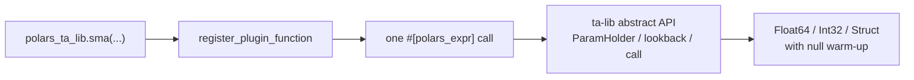

<div align="center">

<h1>polars_ta_lib</h1>

<p><strong>237 TA-Lib indicators as native Polars expressions.</strong></p>

[](https://github.com/huangbogeng/polars-ta-lib/actions/workflows/ci.yml)
[](https://pypi.org/project/polars-ta-lib-extension/)
[](https://huangbogeng.github.io/polars-ta-lib/)
[](LICENSE)
[](https://www.python.org/)
[](https://pola.rs/)
[](https://ta-lib.org/)
[](https://www.rust-lang.org/)

</div>

---

`polars_ta_lib` exposes every TA-Lib 0.8.3 indicator as a Polars expression
plugin. The backend is TA-Lib's official pure-Rust crate: no C toolchain, no
global initialization, and no per-row Python callbacks.

| | |
|---|---|
| **Indicators** | 237, across all 10 TA-Lib groups |
| **Backend** | [`ta-lib`](https://crates.io/crates/ta-lib) 0.8.3, pure Rust |
| **API** | Top-level functions: `pta.sma(...)`, `pta.atr(...)`, `pta.macd()` |
| **Inputs** | Dense, finite numeric columns; conventional column defaults |
| **Outputs** | `Float64`, `Int32`, or a `Struct` of outputs |
| **Warm-up rows** | Polars `null`, never NaN/0 sentinels |
| **Docs** | MkDocs Material, generated from TA-Lib metadata |

## Install

> Available on PyPI as **`polars_ta_lib_extension`**
> (canonical: [`polars-ta-lib-extension`](https://pypi.org/project/polars-ta-lib-extension/)).

```bash
# from PyPI
pip install polars_ta_lib_extension

# from source
uv venv
uv pip install maturin "polars>=2.1,<3"
uv run maturin develop --uv
```

Requirements: Python 3.11+, Polars 2.1+, Rust 1.95+.

PyPI distribution is `polars_ta_lib_extension`; the Python import remains
`polars_ta_lib`.

### Compatibility

| Polars | Python | Status |
|---|---|---|
| 2.1.0 | 3.11 | tested |
| 2.1.0 | 3.12 | tested |

## Quick start

```python
import polars as pl
import polars_ta_lib as pta

df = pl.DataFrame(
    {
        "open":   [1.0, 2.0, 3.0, 4.0, 5.0],
        "high":   [2.0, 3.0, 4.0, 5.0, 6.0],
        "low":    [0.5, 1.5, 2.5, 3.5, 4.5],
        "close":  [1.0, 2.0, 3.0, 4.0, 5.0],
        "volume": [10.0, 20.0, 30.0, 40.0, 50.0],
    }
)

out = df.with_columns(
    pta.sma(time_period=3).alias("sma3"),
    pta.atr(time_period=3).alias("atr3"),
    pta.macd().struct.field("macd_signal").alias("macd_signal"),
    pta.cdlengulfing().alias("engulfing"),
)
```

```text
shape: (5, 9)
┌──────┬──────┬─────┬───────┬───┬──────┬──────┬─────────────┬───────────┐
│ open ┆ high ┆ low ┆ close ┆ … ┆ sma3 ┆ atr3 ┆ macd_signal ┆ engulfing │
│ f64  ┆ f64  ┆ f64 ┆ f64   ┆   ┆ f64  ┆ f64  ┆ f64         ┆ i32       │
╞══════╪══════╪═════╪═══════╪═══╪══════╪══════╪═════════════╪═══════════╡
│ 1.0  ┆ 2.0  ┆ 0.5 ┆ 1.0   ┆ … ┆ null ┆ null ┆ null        ┆ null      │
│ 2.0  ┆ 3.0  ┆ 1.5 ┆ 2.0   ┆ … ┆ null ┆ null ┆ null        ┆ null      │
│ 3.0  ┆ 4.0  ┆ 2.5 ┆ 3.0   ┆ … ┆ 2.0  ┆ null ┆ null        ┆ 0         │
│ 4.0  ┆ 5.0  ┆ 3.5 ┆ 4.0   ┆ … ┆ 3.0  ┆ 2.0  ┆ null        ┆ 0         │
│ 5.0  ┆ 6.0  ┆ 4.5 ┆ 5.0   ┆ … ┆ 4.0  ┆ 2.0  ┆ null        ┆ 0         │
└──────┴──────┴─────┴───────┴───┴──────┴──────┴─────────────┴───────────┘
```

## API

### Input defaults

Single-series indicators default to `close`; price components default to the
column of the same name. Multiple real inputs are required.

```python
pta.sma(time_period=20)                    # pl.col("close")
pta.atr(time_period=14)                    # high, low, close
pta.cdlengulfing()                         # open, high, low, close
pta.beta(pl.col("a"), pl.col("b"))         # required
```

| Input | Default |
|---|---|
| `real` | `pl.col("close")` |
| `real0` / `real1` | required |
| `periods` | `pl.col("periods")` |
| price components | `pl.col("high")`, `pl.col("low")`, … |

### Multi-output

Multi-output indicators return a `Struct`; access a field with
`.struct.field(...)` or unnest the column.

```python
pta.macd()          # macd, macd_signal, macd_hist
pta.bbands()        # upper_band, middle_band, lower_band
pta.stoch()         # slow_k, slow_d
pta.minmaxindex()   # min_idx, max_idx
```

### Parameters

Names are snake_case. TA-Lib's original names stay available in the metadata.
List parameters accept the numeric value or its display name.

```python
pta.ma(time_period=20, ma_type="sma")
pta.ma(time_period=20, ma_type=0)
```

Inspect everything at runtime:

```python
pta.FUNCS["atr"]   # metadata: inputs, params, defaults, outputs
pta.functions()    # all 237 entries
```

### Grouping

Use `.over("symbol")`. Each group starts its own warm-up window.

```python
df.with_columns(
    pta.sma(time_period=20).over("symbol").alias("sma20")
)
```

Sort by time within each symbol before computing history-dependent indicators.

## Semantics

### Input contract

Inputs must be numeric, dense, and finite. Null, NaN, or ±Inf raises a
`ComputeError` naming the column and position:

```text
input `close` contains 1 null(s), first at index 1;
drop, fill or forward-fill them before using TA-Lib
```

Clean explicitly:

```python
df.filter(pl.col("close").is_not_null())
# or
df.with_columns(pl.col("close").forward_fill())
```

### Output contract

- Rows before an indicator's lookback are **Polars null**, including `Int32`
  outputs. `0` is never a missing sentinel.
- Output length always equals input length.
- Empty or too-short inputs return a correctly typed, all-null column.
- TA-Lib may produce NaN or ±Inf for math transforms (for example `acos`
  outside `[-1, 1]`); those values pass through unchanged.

## Performance

Local smoke test, `dev` build, 1M rows, 16 threads. Not a benchmark.

| Indicator | Time |
|---|---:|
| SMA(20) | 28.7 ms |
| EMA(20) | 19.9 ms |
| RSI(14) | 21.6 ms |
| ATR(14) | 54.8 ms |
| MACD(12, 26, 9) | 27.3 ms |

The hot path borrows a dense single-chunk `Float64` column without copying,
allocates each output once, and lets TA-Lib write directly into the final
buffer.

## How it works



- Python functions are generated at import time from
  `_internal.functions_json()`, so a new TA-Lib release needs no hand-written
  wrappers.
- The Rust engine binds inputs and parameters through TA-Lib's abstract API and
  returns full-length buffers; the plugin boundary adds the null validity
  bitmap.
- One generic plugin expression covers all 237 indicators.

## Testing

```bash
uv run pytest -q
```

The suite covers:

- all 237 functions, compared against `polars-talib-fast==2.0.0`;
- parameter parity (`SMA`, `BBANDS`, `MACD`, `STOCH`);
- grouped `.over()`, empty/short inputs, multi-chunk inputs;
- `Int32`/`Float32` casts, null/NaN/Inf errors, invalid parameters.

Current status: **24 tests passed**.

## Documentation

The API reference is generated from `pta.FUNCS` with MkDocs Material:

```bash
uv pip install "mkdocs>=1.6,<2" mkdocs-material
python tools/generate_docs.py
mkdocs build --strict      # output in site/
# or: mkdocs serve
```

- [Architecture](ARCHITECTURE.md)
- [Implementation plan](PLAN.md)
- [Publishing to PyPI](PUBLISHING.md)
- [TA-Lib license](LICENSES/TA-Lib.txt)

## Status

Core v1 is complete:

- [x] 237 top-level functions
- [x] Pythonic parameter and Struct field names
- [x] Polars-native null output
- [x] Generated signatures, docstrings, and type stubs
- [x] 237-function parity tests
- [x] MkDocs API reference
- [x] abi3 wheel build

Not yet included:

- `.ta` expression namespace
- `unstable_period` / candle-settings configuration
- streaming / incremental API
- Series-level API

## License

MIT. TA-Lib is BSD-3-Clause; see [NOTICE](NOTICE) and
[LICENSES/TA-Lib.txt](LICENSES/TA-Lib.txt).
